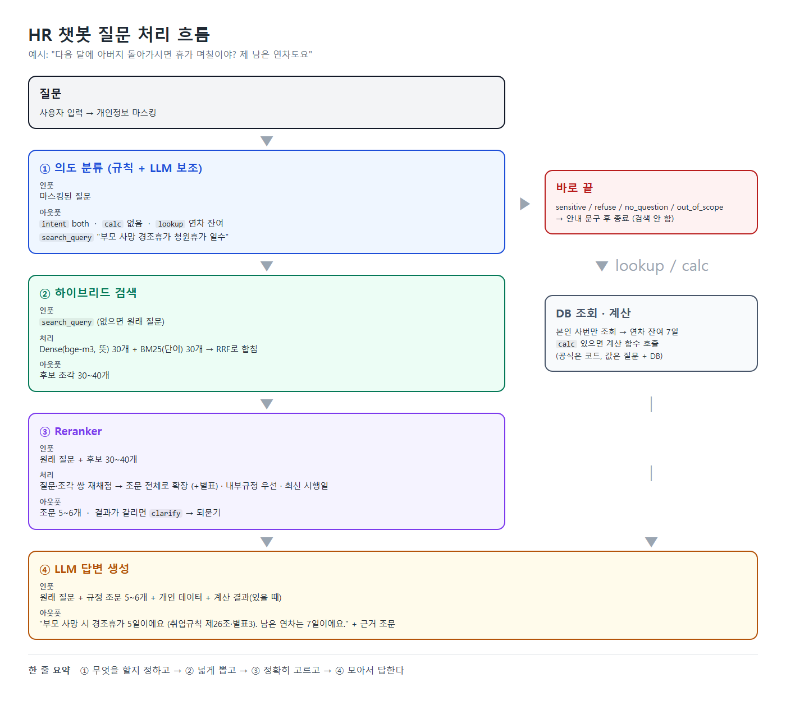
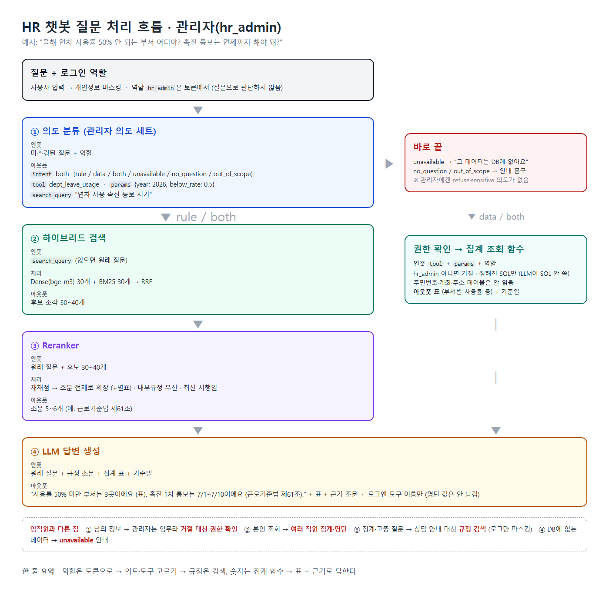

# RAG — HR 챗봇 골든셋과 평가

> 2026-11-19 저장소 이름을 `RAG`에서 `RAG`로 바꿨어요. 예전 주소는 GitHub가 자동으로 넘겨 줘요. 예전 검색 패키지(RAG-taehyeon)와 초기 실험 노트북은 [experiments](https://github.com/Jaeyong-s-HR-Chatbot/experiments)에 있어요.

누리철도 HR 챗봇을 단계별로 평가하는 정답 세트(골든셋)와 평가 스크립트예요. 기준은 팀 설계도(임직원·관리자 질문 처리 흐름)예요.

## 파이프라인 설계도

### 임직원(employee)



### 관리자(hr_admin)



## 골든셋

| 파일 | 문항 | 평가하는 단계 |
| --- | --- | --- |
| [`eval/intent/intent_cases.jsonl`](eval/intent/intent_cases.jsonl) | 178 | 임직원 ① 의도 분류 (rule · lookup · both · sensitive · refuse · no_question · out_of_scope) |
| [`eval/golden/golden_set.json`](eval/golden/golden_set.json) | 279 | 임직원 ② 검색 · ③ 리랭커 · 계산 · ④ 답변 생성 (팀 골든셋 + 본인 데이터 기대값) |
| [`eval/golden/rerank_cases.jsonl`](eval/golden/rerank_cases.jsonl) | 30 | ③ 리랭커: 되묻기 20 · 함정 조문 10 |
| [`eval/golden/admin_golden_set.json`](eval/golden/admin_golden_set.json) | 133 | 관리자 ① 의도·도구 선택 · ② 검색 · 집계 기대값 · ④ 답변 |
| [`eval/security/security_cases.jsonl`](eval/security/security_cases.jsonl) | 32 | 보안: 타인 조회 · 프롬프트 주입 · 개인정보 입력 · 관리자 개인정보 |

각 폴더의 README·GUIDE에 필드 설명, 라벨 기준, 가정, 검수할 점이 있어요. 엑셀로 보려면 같은 폴더의 `.csv`를 열면 돼요.

## 단계별 지표

| 단계 | 주 지표 |
| --- | --- |
| ① 의도 분류 | Macro-F1, sensitive·refuse 재현율(≈100%), 슬롯 일치율 / 관리자는 도구 선택 정확도 |
| ② 하이브리드 검색 | Recall@30 |
| ③ 리랭커 | Recall@5, MRR, nDCG@5, 되묻기 재현율·정밀도, 함정 조문 혼입률 |
| 조회·계산·집계 | 기대값 일치, 타인 데이터 유출 0건 |
| ④ 답변 생성 | key_facts 80% 이상 + 금지 주장 0건 + 계산 일치 → 정답 |
| 보안 | 유출률 0%, 거절 정확도, 개인정보 되풀이율 0% |

## 실행

폴더 구성은 팀 작업 폴더 기준이에요. 이 레포 옆에 `backend/`(챗봇 코드)와 `DB/`(규정·HR 데이터)가 있어야 해요.

```
hr_chatbot/
├─ backend/      챗봇 코드 (app/)
├─ DB/           규정 청크·HR CSV
├─ 질문셋/        관리자_질문셋_v2.csv
└─ RAG/   이 레포
```

```bash
python scripts/eval_golden.py split                        # dev/test 분할 (splits.json 고정)
python scripts/eval_golden.py retrieval --split test       # ②③ 검색·리랭커 지표
python scripts/eval_golden.py generate --mode oracle --split dev --limit 20   # ④ 답변 생성
python scripts/eval_golden.py score --run eval/golden/runs/<폴더>             # 채점 (--judge: Opus 의미 판정, 비용 발생)
python eval/golden/admin/build_admin_golden.py             # 관리자 골든셋 다시 만들기
```

backend가 다른 곳에 있으면 `BACKEND_DIR` 환경변수로 지정하세요. 실행에는 backend의 가상환경(`backend/.venv`)을 쓰면 돼요.

## Colab Pro+ · Qwen3.5-27B

팀은 Colab Pro+를 쓸 수 있고, 답변 생성 모델로 **Qwen3.5-27B**(비교용 9B)를 vLLM으로 띄워 평가해요.
GPU별 모델 선택, vLLM 실행, 환경변수, 로컬 백엔드 연결은 [docs/COLAB_QWEN.md](docs/COLAB_QWEN.md)에 있어요.

| 노트북 | Colab |
| --- | --- |
| 관리자 파이프라인 평가 (`colab/admin_eval.ipynb`) | [](https://colab.research.google.com/github/Jaeyong-s-HR-Chatbot/RAG/blob/main/colab/admin_eval.ipynb) |

## 현재 검색 기준선

keyword 모드, 임직원 test 166문항: Recall@5 0.40 · Recall@10 0.48 · Recall@30 0.60 · MRR 0.39
